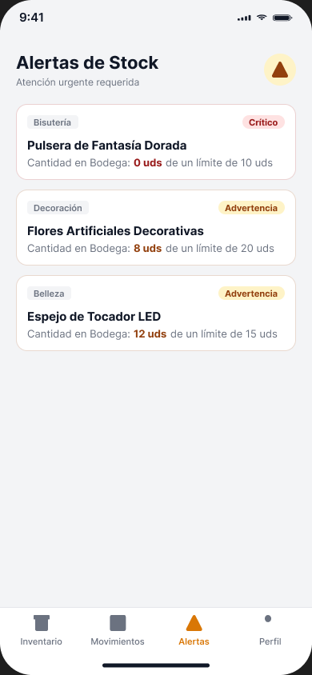

# Comerciales Mely

Sistema académico multiplataforma para inventario, movimientos de bodega, facturación y reportes. Proyecto de DPS941, Universidad Don Bosco, Ciclo II-2026, equipo R.E.F.E.S.

> **Integración final (22 de noviembre de 2026):** el destino final es el Firebase original del equipo, `comerciales-mely` (Firestore `nam5`). Se conservaron sus datos y se publicaron reglas por rol. Pasaron la compilación web, 16 casos de reglas, 12 pruebas de dominio móvil, 3 de calendario y la comprobación de configuración. El adaptador móvil y la interfaz web local probaron correo, roles, movimientos y ventas reales en ese proyecto. La publicación web se actualiza desde `main`; las APK se están regenerando para repetir la aceptación nativa contra el Firebase original. Ver [registro del entorno original](mobile/output/evidence/PRUEBAS-FIREBASE-ORIGINAL-20261122.md) y [matriz de criterios](mobile/docs/CRITERIOS.md).

## Aplicaciones

| Plataforma | Código | Tecnología | Persistencia actual |
| --- | --- | --- | --- |
| Web | raíz (`pages/`, `components/`, `services/`) | React 18, Next.js 14 y Firebase Web SDK | Cloud Firestore compartido; [despliegue Vercel](https://comerciales-mely-web.vercel.app) |
| Android/iOS | [`mobile/`](mobile/) | React Native, Expo Router y Firebase SDK | Cloud Firestore compartido; Firebase Authentication mantiene la sesión |

Ambas aplicaciones implementan inventario, entradas/salidas, ventas con IVA del 13 %, control de existencias y reportes. Los cambios de productos, movimientos y facturas se escriben en las colecciones compartidas `productos`, `movimientos` y `facturas`; las cuentas y roles están en `usuarios/{uid}`. Las operaciones de stock se escriben junto con su movimiento en una transacción.

## Requisitos

- Node.js 20 o superior para la web; Node.js >=22.13 para Expo móvil y npm. Las pruebas de esta entrega se realizaron con Node 24.
- Para Android: Android Studio, Android SDK/NDK y JDK compatibles con Expo SDK 58. Para los pasos comprobados en este equipo, ver [`mobile/README.md`](mobile/README.md).
- La web utiliza la configuración pública versionada en [`config/firebase-client.json`](config/firebase-client.json), fijada al Firebase original del equipo. Para móvil, copia `mobile/.env.example` a `mobile/.env`.

## Ejecutar la web

```powershell
npm ci
npm run dev
```

Abre `http://localhost:3000`. Para compilar y servir la versión de producción:

```powershell
npm run build
npm run start
```

La web incluye acceso por correo, registro con rol limitado, inicio social con Google, dashboard, inventario, movimientos, facturación, usuarios y reportes. Authentication y Firestore comprueban la sesión y las reglas de rol en el servidor de Firebase. Las antiguas rutas API permanecen cerradas por middleware.

## Ejecutar la app móvil

```powershell
cd mobile
npm ci
Copy-Item .env.example .env
npm run start
```

Para construir el APK de Android en un entorno preparado:

```powershell
npm run build:android
```

La guía móvil explica Authentication, Google Sign-In, Firestore, permisos por rol, exportación de comprobantes y compilación nativa. Consulta [`mobile/README.md`](mobile/README.md), [`mobile/FIREBASE.md`](mobile/FIREBASE.md) y [`mobile/ENTREGA.md`](mobile/ENTREGA.md).

## Mockups de la Etapa 1

Diseños de referencia conservados dentro del repositorio. La app móvil mantiene colores, tipografía y estructura de las pantallas base.

### Inicio de sesión


### Inventario


### Producto


### Movimiento de inventario


### Alertas



Archivo de Figma informado por el equipo: `11GPTpTj3RrHusfOA9qqOr`. Nodos y notas de diseño: [documentación móvil](mobile/README.md#diseño-verificado).

## Evaluación final

| Criterio | Evidencia y estado |
| --- | --- |
| Web React + Next.js | Aplicación publicada en [Vercel](https://comerciales-mely-web.vercel.app), vinculada a `main` |
| App móvil React Native | Código Expo, 12 pruebas de dominio, exportación final Android/iOS y APK x86_64 compilada/firmada; adaptador Firebase probado remotamente. Instalación y aceptación Android en verificación |
| Correo y red social en ambas | Sesión Google web comprobada; acceso móvil por correo probado desde su adaptador de datos. Google Sign-In nativo Android pendiente de prueba |
| Módulos principales/secundarios | Inventario, bodega, ventas y reportes probados en web como Administrador; permisos del Facturador probados contra Firebase. Falta completar la aceptación de pantallas Android y cada rol |
| Firestore compartido | En el proyecto original: adaptador móvil 25 → 24, venta desde interfaz web 24 → 23. Transacciones y permisos verificados; pendiente repetir pantallas nativas con la APK nueva |
| UX/UI alineada con Figma | Mockups de la Etapa 1 publicados arriba y guía visual conservada en el repositorio |
| Licencia Creative Commons | [`LICENCIA-CONTENIDO.md`](LICENCIA-CONTENIDO.md) describe la licencia del material del proyecto |
| Colaboración | Ramas y atribuciones documentadas en [`mobile/docs/COLABORACION.md`](mobile/docs/COLABORACION.md); cuatro invitaciones de escritura enviadas. Cada integrante debe aceptar y aportar sus commits auténticos |
| Originalidad | Se conserva la identidad e historial del equipo y se atribuye el código reutilizado del repositorio colaborador |

El repositorio y Firebase originales del compañero forman parte del trabajo del mismo equipo. Con autorización del propietario de esta entrega, la integración final reutiliza ese Firebase y conserva su catálogo e historial. Las reglas anteriores permitían acceso sin sesión y se sustituyeron por las reglas de este repositorio. La procedencia del código y los aportes se mantienen documentados.

## Pruebas reproducibles

Desde la raíz, `npm run test:rules` inicia un emulador Firestore con el proyecto de demostración `demo-mely-rules` y ejecuta los 16 casos de permisos y ventas atómicas. Requiere Java 21 o superior; no modifica el Firebase remoto. Desde `mobile/`, ejecuta `npm test`, `npm run lint` y `npm run typecheck`. Ejecuta también `npm run test:calendar` y `npm run test:config` desde la raíz (las pruebas de calendario comparan el módulo móvil; instala antes las dependencias de `mobile/`). La aceptación remota del proyecto original y sus datos QA se describen en [su registro del 22 de noviembre](mobile/output/evidence/PRUEBAS-FIREBASE-ORIGINAL-20261122.md).

## Seguridad y configuración

- `.env.local` y `mobile/.env` están excluidos por `.gitignore`. La configuración Firebase de cliente identifica el proyecto y no reemplaza reglas de seguridad; no publiques claves privadas ni contraseñas.
- El primer administrador debe crearse como usuario normal y luego asignarse a `Administrador` en Firebase Console. El cliente nunca permite autoasignarse ese rol.
- Las altas web con correo y contraseña y las cuentas Google nuevas empiezan como `Empleado`; el alta móvil permite `Empleado` o `Facturador`.
- La web usa `config/firebase-client.json` para evitar que variables antiguas de Vercel vuelvan a conectarla al Firebase temporal. La autorización del dominio `comerciales-mely-web.vercel.app` en el Firebase original requiere confirmación del propietario antes de verificar Google en producción.
- El proyecto tiene registrada la app Android `com.anonymous.comercialesmelymovil` y la huella SHA-1 de depuración de este equipo. El ID OAuth Web público aparece en `mobile/.env.example`; para compilar en otra máquina registra allí el SHA-1 de la clave que se vaya a usar.
- El proyecto Firebase está en el plan Spark. Cuotas y límites del plan aplican; no se activó facturación ni respaldos programados de pago.

## Licencia

El aviso de Creative Commons de este proyecto delimita el material original y sus excepciones en [`LICENCIA-CONTENIDO.md`](LICENCIA-CONTENIDO.md). La aplicación móvil conserva su archivo [`mobile/LICENSE`](mobile/LICENSE); las licencias y atribuciones de dependencias y aportes de terceros prevalecen para esos componentes.

## Historial y colaboración

Repositorio de entrega: [wilfredo409/comerciales-mely-web](https://github.com/wilfredo409/comerciales-mely-web). La rama de trabajo final es `main`. Los integrantes, ramas de trabajo e información sobre el historial se mantienen en [`mobile/docs/COLABORACION.md`](mobile/docs/COLABORACION.md). Todos los cambios que se entreguen deben permanecer documentados y dentro de este repositorio.
