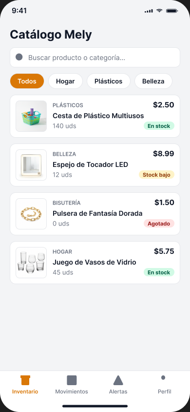
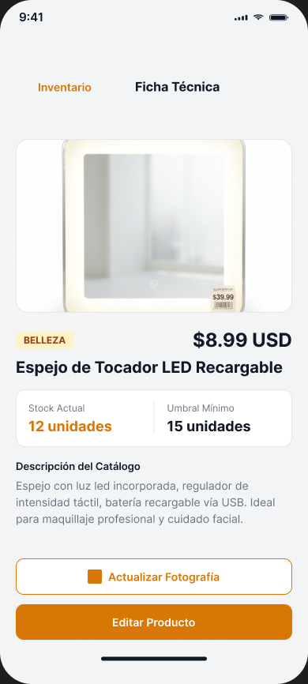

# Comerciales Mely

Sistema académico multiplataforma para inventario, movimientos de bodega, facturación y reportes. Proyecto de DPS941, Universidad Don Bosco, Ciclo II-2026, equipo R.E.F.E.S.

> **Estado de integración (22 de noviembre de 2026):** la web está desplegada en [comerciales-mely-web.vercel.app](https://comerciales-mely-web.vercel.app). Web y móvil apuntan al proyecto Firebase `comerciales-mely-final`; Authentication tiene correo/contraseña y Google habilitados, Firestore está en `us-central1` y las reglas de [`firestore.rules`](firestore.rules) están publicadas. La configuración cliente permanece en archivos locales ignorados por Git. La exportación JavaScript Android/iOS pasó; no se produjo la APK porque Gradle no logró iniciar un script CMake desde la ruta local con espacios y acento. La prueba de inicio de sesión/sincronización con cuentas reales también queda pendiente. Ver [Firebase](mobile/FIREBASE.md) y la [matriz de criterios](mobile/docs/CRITERIOS.md).

## Aplicaciones

| Plataforma | Código | Tecnología | Persistencia actual |
| --- | --- | --- | --- |
| Web | raíz (`pages/`, `components/`, `services/`) | React 18, Next.js 14 y Firebase Web SDK | Cloud Firestore compartido; [despliegue Vercel](https://comerciales-mely-web.vercel.app) |
| Android/iOS | [`mobile/`](mobile/) | React Native, Expo Router y Firebase SDK | Cloud Firestore compartido; Firebase Authentication mantiene la sesión |

Ambas aplicaciones implementan inventario, entradas/salidas, ventas con IVA del 13 %, control de existencias y reportes. Los cambios de productos, movimientos y facturas se escriben en las colecciones compartidas `productos`, `movimientos` y `facturas`; las cuentas y roles están en `usuarios/{uid}`. Las operaciones de stock se escriben junto con su movimiento en una transacción.

## Requisitos

- Node.js 20 o superior y npm.
- Para Android: Android Studio, Android SDK/NDK y JDK compatibles con Expo SDK 58. Para los pasos comprobados en este equipo, ver [`mobile/README.md`](mobile/README.md).
- Variables de tu proyecto Firebase en `.env.local` y `mobile/.env`; las plantillas están en `.env.example` y `mobile/.env.example`. No subas los archivos locales.

## Ejecutar la web

```powershell
npm ci
Copy-Item .env.example .env.local
npm run dev
```

Abre `http://localhost:3000`. Para compilar y servir la versión de producción:

```powershell
npm run build
npm run start
```

La web incluye acceso por correo, registro con rol limitado, inicio social con Google, dashboard, inventario, movimientos, facturación, usuarios y reportes. Authentication y Firestore comprueban la sesión y las reglas de rol en el servidor de Firebase. Las antiguas rutas API permanecen cerradas por middleware.

## Ejecutar la app móvil

```powershell
cd mobile
npm ci
Copy-Item .env.example .env
npm run start
```

Para construir el APK de Android en un entorno preparado:

```powershell
npm run build:android
```

La guía móvil explica Authentication, Google Sign-In, Firestore, permisos por rol, exportación de comprobantes y compilación nativa. Consulta [`mobile/README.md`](mobile/README.md), [`mobile/FIREBASE.md`](mobile/FIREBASE.md) y [`mobile/ENTREGA.md`](mobile/ENTREGA.md).

## Mockups de la Etapa 1

Diseños de referencia conservados dentro del repositorio. La app móvil mantiene colores, tipografía y estructura de las pantallas base.

### Inicio de sesión


### Inventario



### Producto



### Movimiento de inventario


### Alertas


Archivo de Figma informado por el equipo: `11GPTpTj3RrHusfOA9qqOr`. Nodos y notas de diseño: [documentación móvil](mobile/README.md#diseño-verificado).

## Evaluación final

| Criterio | Evidencia y estado |
| --- | --- |
| Web React + Next.js | Aplicación publicada en [Vercel](https://comerciales-mely-web.vercel.app), vinculada a `main` |
| App móvil React Native | Código Expo, pruebas de lógica y exportación JavaScript móvil; la APK no se generó en esta ruta Windows y aún falta probarla en Android |
| Correo y red social en ambas | Firebase tiene correo/contraseña y Google habilitados; web tiene el dominio Vercel autorizado. Falta una prueba real de OAuth y del módulo nativo Android |
| Módulos principales/secundarios | Inventario, bodega, ventas, reportes, usuarios y alertas implementados; falta recorrido de aceptación con cuentas de cada rol |
| Firestore compartido | Ambas plataformas usan el proyecto `comerciales-mely-final`; reglas publicadas y operaciones de inventario/venta transaccionales. Falta validar sincronización con datos de prueba reales |
| UX/UI alineada con Figma | Mockups de la Etapa 1 publicados arriba y guía visual conservada en el repositorio |
| Licencia Creative Commons | [`LICENCIA-CONTENIDO.md`](LICENCIA-CONTENIDO.md) describe la licencia del material del proyecto |
| Colaboración | Ramas, integrantes y atribuciones documentados en [`mobile/docs/COLABORACION.md`](mobile/docs/COLABORACION.md); el historial Git conserva las contribuciones existentes |
| Originalidad | Se conserva la identidad e historial del equipo y se atribuye el código reutilizado del repositorio colaborador |

El repositorio de referencia del compañero se consultó como fuente de trabajo del equipo. Sus reglas Firestore encontradas permitían cambios demasiado amplios a cualquier usuario autenticado; por ello no se copiaron ni se presenta ese proyecto o su despliegue como propios. Consulta el historial y las atribuciones del equipo antes de integrar código adicional.

## Seguridad y configuración

- `.env.local` y `mobile/.env` están excluidos por `.gitignore`. La configuración Firebase de cliente identifica el proyecto y no reemplaza reglas de seguridad; no publiques claves privadas ni contraseñas.
- El primer administrador debe crearse como usuario normal y luego asignarse a `Administrador` en Firebase Console. El cliente nunca permite autoasignarse ese rol.
- Las altas web con correo y contraseña y las cuentas Google nuevas empiezan como `Empleado`; el alta móvil permite `Empleado` o `Facturador`.
- Vercel ya tiene las seis variables `NEXT_PUBLIC_FIREBASE_*` para producción. La configuración apunta a `comerciales-mely-final`; el dominio `comerciales-mely-web.vercel.app` está autorizado en Firebase Authentication.
- El proyecto tiene registrada la app Android `com.anonymous.comercialesmelymovil` y la huella SHA-1 de depuración de este equipo. El ID OAuth Web está guardado solo en `mobile/.env`; para compilar en otra máquina registra allí el SHA-1 de la clave que se vaya a usar.
- El proyecto Firebase está en el plan Spark. Cuotas y límites del plan aplican; no se activó facturación ni respaldos programados de pago.

## Licencia

El aviso de Creative Commons de este proyecto delimita el material original y sus excepciones en [`LICENCIA-CONTENIDO.md`](LICENCIA-CONTENIDO.md). La aplicación móvil conserva su archivo [`mobile/LICENSE`](mobile/LICENSE); las licencias y atribuciones de dependencias y aportes de terceros prevalecen para esos componentes.

## Historial y colaboración

Repositorio de entrega: [wilfredo409/comerciales-mely-web](https://github.com/wilfredo409/comerciales-mely-web). La rama de trabajo final es `main`. Los integrantes, ramas de trabajo e información sobre el historial se mantienen en [`mobile/docs/COLABORACION.md`](mobile/docs/COLABORACION.md). Todos los cambios que se entreguen deben permanecer documentados y dentro de este repositorio.
