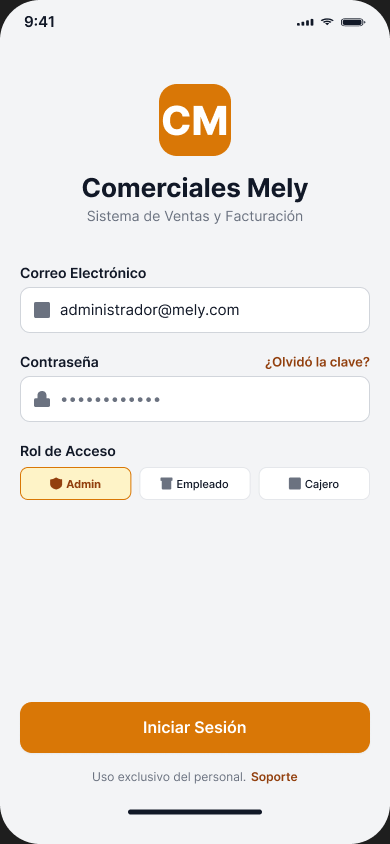
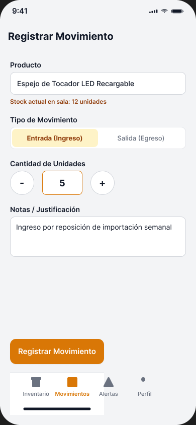

# Comerciales Mely

Sistema académico multiplataforma para inventario, movimientos de bodega, facturación y reportes. Proyecto de DPS941, Universidad Don Bosco, Ciclo II-2026, equipo R.E.F.E.S.

> **Estado de integración:** web y móvil ya usan Firebase Authentication y las mismas colecciones de Cloud Firestore. Las reglas de seguridad están incluidas en este repositorio. La compilación web y móvil está en verificación; Google móvil requiere una compilación nativa y la publicación de reglas/despliegue Vercel aún deben confirmarse. Ver [Firebase](mobile/FIREBASE.md) y la [matriz de criterios](mobile/docs/CRITERIOS.md).

## Aplicaciones

| Plataforma | Código | Tecnología | Persistencia actual |
| --- | --- | --- | --- |
| Web | raíz (`pages/`, `components/`, `services/`) | React 18, Next.js 14 y Firebase Web SDK | Cloud Firestore compartido |
| Android/iOS | [`mobile/`](mobile/) | React Native, Expo Router y Firebase SDK | Cloud Firestore compartido; Firebase Authentication mantiene la sesión |

Ambas aplicaciones implementan inventario, entradas/salidas, ventas con IVA del 13 %, control de existencias y reportes. Los cambios de productos, movimientos y facturas se escriben en las colecciones compartidas `productos`, `movimientos` y `facturas`; las cuentas y roles están en `usuarios/{uid}`. Las operaciones de stock se escriben junto con su movimiento en una transacción.

## Requisitos

- Node.js 20 o superior y npm.
- Para Android: Android Studio, Android SDK/NDK y JDK compatibles con Expo SDK 58. Para los pasos comprobados en este equipo, ver [`mobile/README.md`](mobile/README.md).
- Variables Firebase del equipo en `.env.local` y `mobile/.env`; las plantillas están en `.env.example` y `mobile/.env.example`. No subas los archivos locales.

## Ejecutar la web

```powershell
npm ci
Copy-Item .env.example .env.local
npm run dev
```

Abre `http://localhost:3000`. Para compilar y servir la versión de producción:

```powershell
npm run build
npm run start
```

La web incluye acceso por correo, registro con rol limitado, inicio social con Google, dashboard, inventario, movimientos, facturación, usuarios y reportes. Authentication y Firestore comprueban la sesión y las reglas de rol en el servidor de Firebase. Las antiguas rutas API permanecen cerradas por middleware.

## Ejecutar la app móvil

```powershell
cd mobile
npm ci
Copy-Item .env.example .env
npm run start
```

Para construir el APK de Android en un entorno preparado:

```powershell
npm run build:android
```

La guía móvil explica Authentication, Google Sign-In, Firestore, permisos por rol, exportación de comprobantes y compilación nativa. Consulta [`mobile/README.md`](mobile/README.md), [`mobile/FIREBASE.md`](mobile/FIREBASE.md) y [`mobile/ENTREGA.md`](mobile/ENTREGA.md).

## Mockups de la Etapa 1

Diseños de referencia conservados dentro del repositorio. La app móvil mantiene colores, tipografía y estructura de las pantallas base.

### Inicio de sesión



### Inventario


### Producto


### Movimiento de inventario



### Alertas


Archivo de Figma informado por el equipo: `11GPTpTj3RrHusfOA9qqOr`. Nodos y notas de diseño: [documentación móvil](mobile/README.md#diseño-verificado).

## Evaluación final

| Criterio | Evidencia actual | Pendiente para declararlo completo |
| --- | --- | --- |
| Web React + Next.js | Código en la raíz; compilación de producción | Desplegar esta copia en Vercel y documentar una URL comprobada |
| App móvil React Native | Código Expo, pruebas de lógica y exportación Android/iOS | Generar una nueva APK con Firebase y comprobarla en Android; la IPA/iPhone exige equipo/perfil Apple |
| Correo y red social en ambas | Firebase Auth por correo; Google web y módulo Google nativo móvil | Confirmar proveedores habilitados; probar OAuth web y construir/validar Google Sign-In Android con huella SHA-1 |
| Módulos principales/secundarios | Inventario, bodega, ventas, reportes, usuarios y alertas | Probar todos los flujos contra Firestore compartido con cuentas por rol |
| Firestore compartido | Colecciones y transacciones comunes; reglas en [`firestore.rules`](firestore.rules) | Publicar reglas en Firebase y verificar sincronización con cuentas reales |
| UX/UI alineada con Figma | Pantallas y referencias publicadas arriba | Revisión comparativa final de la versión web y móvil |
| Licencia Creative Commons | [`LICENCIA-CONTENIDO.md`](LICENCIA-CONTENIDO.md) describe la licencia del material del proyecto | Ver alcance de licencias existentes antes de redistribuir código de terceros |
| Colaboración | Ramas y miembros documentados en [`mobile/docs/COLABORACION.md`](mobile/docs/COLABORACION.md) | Cada integrante debe mantener sus propios commits reales; no se inventan contribuciones |
| Originalidad | Se conserva la identidad y el historial del equipo | Las adaptaciones de otro repositorio deben conservar atribución y licencia de origen |

El repositorio de referencia del compañero se consultó como fuente de trabajo del equipo. Sus reglas Firestore encontradas permitían cambios demasiado amplios a cualquier usuario autenticado; por ello no se copiaron ni se presenta ese proyecto o su despliegue como propios. Consulta el historial y las atribuciones del equipo antes de integrar código adicional.

## Seguridad y configuración

- `.env.local` y `mobile/.env` están excluidos por `.gitignore`. La configuración Firebase de cliente identifica el proyecto y no reemplaza reglas de seguridad; no publiques claves privadas ni contraseñas.
- El primer administrador debe crearse como usuario normal y luego asignarse a `Administrador` en Firebase Console. El cliente nunca permite autoasignarse ese rol.
- Las altas web con correo y contraseña y las cuentas Google nuevas empiezan como `Empleado`; el alta móvil permite `Empleado` o `Facturador`.
- Vercel debe recibir las seis variables `NEXT_PUBLIC_FIREBASE_*` del `.env.local`; agrega el dominio del sitio a los dominios autorizados en Firebase Authentication.
- El Google Sign-In nativo necesita el ID OAuth Web y una app Android registrada con el paquete y SHA-1 que se describen en [mobile/FIREBASE.md](mobile/FIREBASE.md).

## Licencia

El aviso de Creative Commons de este proyecto delimita el material original y sus excepciones en [`LICENCIA-CONTENIDO.md`](LICENCIA-CONTENIDO.md). La aplicación móvil conserva su archivo [`mobile/LICENSE`](mobile/LICENSE); las licencias y atribuciones de dependencias y aportes de terceros prevalecen para esos componentes.

## Historial y colaboración

Repositorio de entrega: [wilfredo409/comerciales-mely-web](https://github.com/wilfredo409/comerciales-mely-web). La rama de trabajo final es `main`. Los integrantes, ramas de trabajo e información sobre el historial se mantienen en [`mobile/docs/COLABORACION.md`](mobile/docs/COLABORACION.md). Todos los cambios que se entreguen deben permanecer documentados y dentro de este repositorio.
