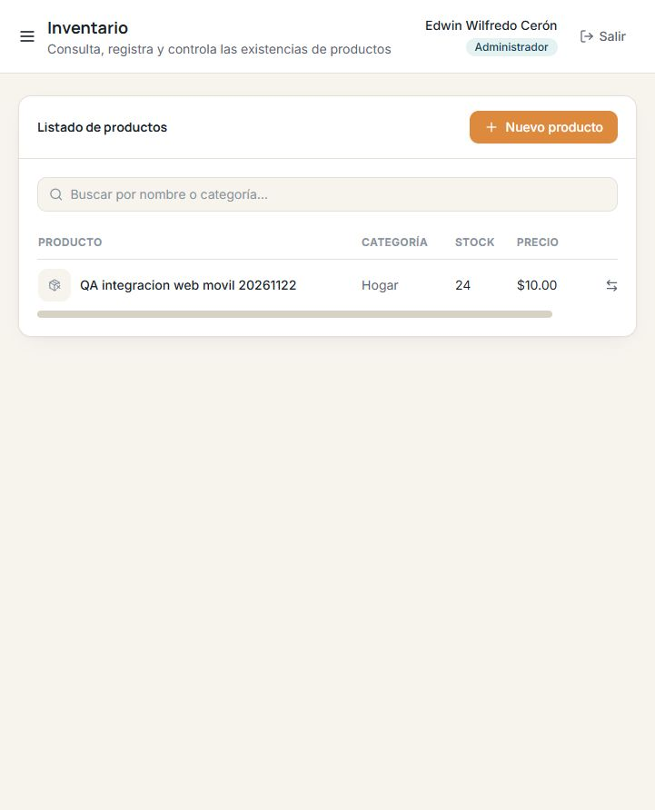
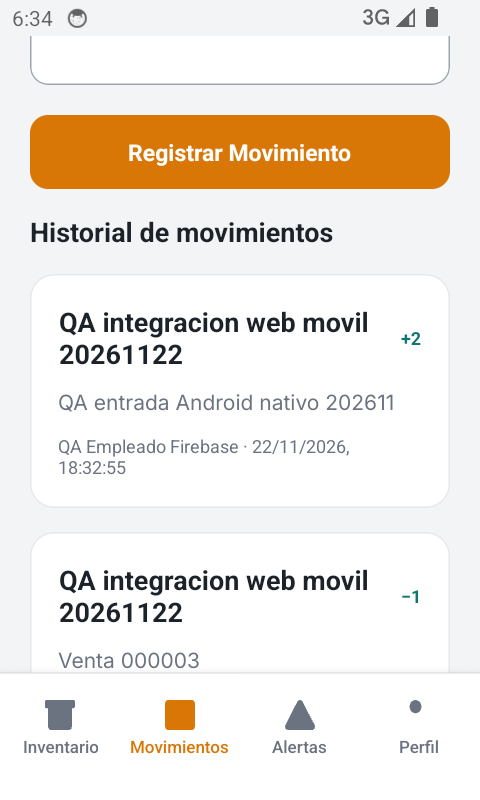
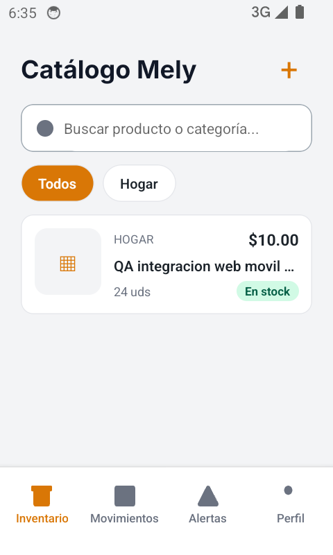

> **Entorno histórico:** estas pruebas nativas y las capturas 35–39 corresponden al Firebase temporal `comerciales-mely-final`. La configuración final migra al proyecto original `comerciales-mely`; su aceptación se registra por separado en [PRUEBAS-FIREBASE-ORIGINAL-20261122.md](PRUEBAS-FIREBASE-ORIGINAL-20261122.md).

# Compilación Android — 22 de noviembre de 2026

## APK x86_64 generada

- Expo SDK 58, React Native 0.88.0, Gradle 9.4.1 y JDK 17.
- Android SDK Build Tools 37.0.0, NDK 27.1.12297006 y Ninja 1.13.2 oficial, preparado dentro de la copia de compilación.
- Compilación local en una ruta ASCII; `GRADLE_USER_HOME` también sin acentos.
- `:app:assembleDebug -PreactNativeArchitectures=x86_64`, con caché de proyecto fuera de `android/`, `--build-cache` y todos los pasos nativos habilitados.
- Resultado: `BUILD SUCCESSFUL in 25m 14s`, 369 tareas (44 ejecutadas y 325 al día).
- La variante final no omitió tareas de compilación. Un intento anterior de reutilizar bibliotecas mediante exclusión de tareas se descartó porque Gradle rechazó sus proveedores de recursos.
- APK: 88.53 MiB; contiene `assets/index.android.bundle` y bibliotecas `lib/x86_64/`.
- Firma verificada con `apksigner verify`; certificado de depuración SHA-1 `5E:8F:16:06:2E:A3:CD:2C:4A:0D:54:78:76:BA:A6:F3:8C:AB:F6:25`.
- Archivo y SHA-256: [directorio de APK](../android/README.md).

## Problema corregido

Ninja 1.10.2 del SDK seguía siendo utilizado por la app, aunque las dependencias recibían una versión nueva. Eso causaba errores con rutas de más de 260 caracteres y regeneraciones de `build.ninja`. El plugin ahora configura Ninja 1.13.2 tanto en la app como en las dependencias. Los 73 objetos C++ de la app y los 67 de Expo Modules Core x86_64 compilaron y la APK se empaquetó correctamente. El script verifica versión y huella SHA-256 de la distribución oficial.

La variante Debug incluye el bundle mediante un config plugin. El historial Gradle se guarda fuera del directorio nativo para conservarlo cuando Expo regenera Android. Los cambios permanecen en plugins y scripts; los proyectos nativos generados no se versionan.

## Preparación del emulador

Android 14 Google APIs y Android Emulator 37.3.10 están instalados. El primer intento no pudo crear la partición de datos porque necesitaba 7,372.8 MB libres. Después de liberar espacio en D se detectó una instalación incompleta de la imagen: `system.img` tenía 3,088,055,440 bytes y faltaban `vendor.img` y `userdata.img`.

Se descargó nuevamente `x86_64-34_r14.zip` desde el repositorio oficial de Google y se verificó su SHA-1 contra el manifiesto: `e0f6c9a0691aa27bd597d0deb1bcfdc943ac8ca7`. La extracción completa restauró `system.img` (4,306,501,632 bytes), `vendor.img` (103,809,024 bytes), `userdata.img` y los archivos de configuración. El perfil aislado `Mely_API34_ASCII`, con datos en D, logró conectarse por ADB como `device`, informó API 34 y montó `/data` con 5.4 GB disponibles. La aceptación de la app requiere que finalice la inicialización del gestor de paquetes.

La exportación final Android/iOS, posterior a la corrección de `normalizeAuthUser`, terminó con código 0 usando `expo export --platform android --platform ios --max-workers 1`. Generó los bundles Hermes `index-efde6b6c1a02b899558d689b6d0f18b7.hbc` (Android) e `index-a37ec8244303f8bcda2d593b16ba3f2a.hbc` (iOS), de 5.1 MB cada uno. Estos bundles no son instaladores iOS.

## Instalación y arranque de la actividad

Android terminó el primer arranque (`sys.boot_completed=1`). `adb install --no-streaming -r` transfirió 92,835,573 bytes y terminó con `Success`; se abrió `com.anonymous.comercialesmelymovil/.MainActivity` y el proceso de la app quedó activo. No había servidor escuchando en el puerto Metro 8081 ni redirecciones ADB hacia Metro. Los registros consultados de `AndroidRuntime` y `ReactNativeJS` no mostraron errores propios de la app.

La interfaz quedó inicialmente bloqueada por avisos ANR de **Process system** y **System UI**, con presión de memoria y E/S del emulador. Se redujo la resolución del perfil de pruebas y se reinició conservando datos, usando la GPU anfitriona. No se presenta ese arranque de proceso como aceptación funcional de pantallas ni prueba de Google.

La compilación, firma, bundle e instalación verificados **no equivalen** a una prueba de pantallas, persistencia nativa ni Google Sign-In. Los recorridos efectivamente completados se registran en la sección siguiente. Las pruebas reales del adaptador móvil contra Firebase y la lectura web del resultado están en [PRUEBAS-FIREBASE-20261122.md](PRUEBAS-FIREBASE-20261122.md).

## Aceptación nativa: recorridos completados

Después de liberar memoria y usar la GPU anfitriona, la APK abrió su formulario **sin Metro** y permitió los siguientes recorridos reales:

| Prueba | Resultado observado |
| --- | --- |
| Correo y rol Empleado | Acceso con la cuenta sintética `QA Empleado Firebase`; catálogo remoto con precio $10.00 y stock 22 |
| Entrada de inventario | Desde Movimientos se seleccionó el producto QA, se ingresaron 2 unidades y una justificación. El historial muestra `+2`, usuario QA y fecha 22/11/2026 18:32:55 |
| Lectura web de la escritura Android | Se recargó el inventario publicado en Vercel y mostró stock 24, frente a 22 antes de la entrada |
| Persistencia nativa | Se forzó el cierre del proceso y se abrió de nuevo. La sesión Empleado se restauró sin solicitar credenciales y el catálogo mostró 24 unidades |
| Opciones por rol | El perfil Empleado mostró su rol y no ofreció Ventas/Facturación ni Reportes, reservados a los roles autorizados |
| Alertas vacías | Con stock 24 y mínimo 5, la pantalla indicó que no hay productos con stock bajo |
| Cierre de sesión | Confirmación nativa y regreso al formulario de acceso |

Las credenciales sintéticas se validaron directamente contra Authentication sin publicar contraseña ni token. Durante la automatización se verificaron los campos en privado para evitar confundir retrasos del teclado con fallos del servicio.

Se detectó un subtítulo de urgencia incluso cuando no existían alertas; se ajustó el texto para distinguir el estado vacío. Las 12 pruebas de dominio, lint y tipos volvieron a finalizar sin errores después del cambio. La APK definitiva debe regenerarse para incluir ese ajuste visual.

Los recorridos nativos Cajero, Google y exportación de comprobantes continúan en verificación. iOS solo tiene exportación JavaScript comprobada; no se dispone aquí de firma y dispositivo Apple para una aceptación nativa.
