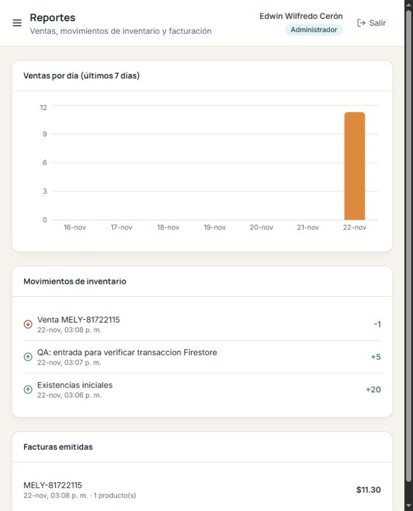
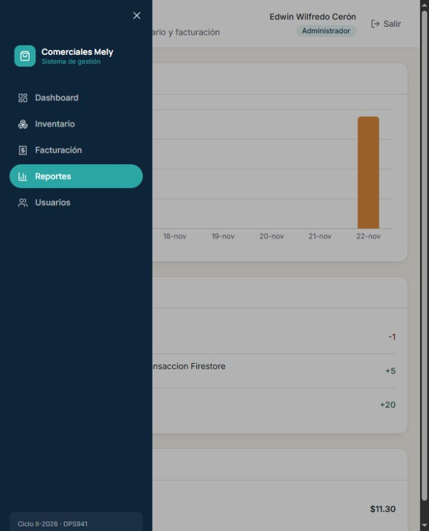
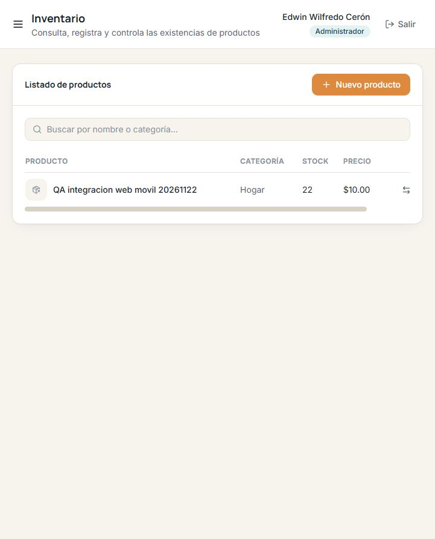

# Pruebas contra Firebase — 22 de noviembre de 2026

Entorno: web publicada en Vercel, proyecto Firebase `comerciales-mely-final`, cuenta real del equipo con rol Administrador. Las operaciones siguientes se realizaron desde la interfaz web contra Firestore remoto. Son datos académicos de prueba, identificados con el prefijo QA.

| Recorrido | Resultado observado |
| --- | --- |
| Sesión con Google existente | Dashboard, inventario, facturación y reportes accesibles |
| Crear producto | `QA integracion web movil 20261122`, categoría Hogar, precio $10.00, stock 20 y mínimo 5 |
| Entrada de inventario | Cinco unidades; stock actualizado a 25 y movimiento guardado |
| Facturar una unidad | Factura `MELY-81722115`, subtotal $10.00, IVA $1.30 y total $11.30 |
| Reportes tras recargar | Venta y los tres movimientos visibles: inicial +20, entrada +5 y venta -1 |
| Menú en pantalla estrecha | Después del arreglo, aparecen los cinco módulos; el enlace Inventario navega y cierra el panel |
| Compilación web | `npm run build` completado; se desactivó la descarga de CSS de fuentes durante la compilación para evitar bloqueos de red |
| Reglas por rol, emulador Firestore | 16 casos aprobados: venta del Facturador, varios productos, rechazo de facturas reutilizadas y escrituras indebidas; suite reproducible en `tests/firestore-rules.test.mjs` desde la raíz |
| Facturador, Firebase remoto con SDK | Cuenta sintética QA: factura `MELY-QA-1795383569225`, stock 24 → 23; cambio de precio y lectura sin sesión rechazados |
| Código de datos móvil, Firebase remoto | `database.js` y `business.mjs` ejecutados con Node; rol incorrecto rechazado, correo válido, venta sin stock rechazada, factura `MELY-000003` por $11.30, stock 23 → 22, recarga y cierre de sesión correctos |
| Lectura web posterior | La interfaz publicada muestra stock 22 tras la escritura del adaptador móvil; captura 33 |

La prueba adicional detectó una importación inexistente de `normalizeAuthUser`. Se implementó la normalización de las etiquetas de rol compartidas con la web y el rechazo de roles desconocidos. Una prueba de regresión cubre este fallo. La suite local móvil tiene 12 pruebas aprobadas; la prueba remota es optativa y se ejecutó por separado con éxito.

## Evidencia visual







## Alcance

Estos resultados verifican la web con la cuenta administradora usada y los datos QA indicados. Las capturas antiguas de Foro 1 pertenecen a la versión SQLite; no prueban la integración actual de Firebase. La lectura desde una app Android instalada y la prueba nativa de Google se registrarán por separado cuando se completen.

La prueba remota del Facturador usa el SDK Firebase y una cuenta sintética; no sustituye un recorrido de su interfaz. Las reglas probadas se publicaron en Firebase Console el 22/11/2026 a las 15:37 (hora local). Las credenciales QA permanecen fuera del repositorio.

## Repetir la prueba del adaptador móvil

Desde `mobile/`, con Node 24 y las variables de `mobile/.env` configuradas:

```powershell
$env:MELY_QA_ACCOUNT_FILE = 'C:\ruta-privada\cuenta-qa.json'
node --test tests/firebase-live.test.mjs
```

El archivo privado contiene `email` y `password` de una cuenta sintética con rol Facturador. No debe subirse a Git. La prueba descuenta una unidad únicamente del producto `QA integracion web movil 20261122`; requiere precio $10.00 y al menos dos unidades. Sustituye las interfaces de plataforma de Crypto y React Native, y la inicialización persistente de sesión, para ejecutar el código de datos original en Node. Authentication, Firestore y sus reglas son reales. No verifica pantallas, almacenamiento nativo de sesión ni Google Sign-In nativo.
