# Verificación del Firebase original — 22/11/2026

## Entorno final

- Proyecto del equipo: `comerciales-mely`, número `945325242075`.
- Firestore existente: `(default)`, ubicación `nam5`.
- Aplicaciones ya registradas: web `mely-web` y Android `com.anonymous.comercialesmelymovil`.
- Correo/contraseña y Google habilitados. SHA-1 Android coincide con la firma de las APK de esta entrega.
- Respaldo privado previo: 9 productos, 20 movimientos, 2 facturas y 9 perfiles. No se eliminó ni reemplazó el catálogo del equipo. El respaldo contiene datos de usuarios y no se publica.
- Reglas de `firestore.rules` publicadas a las 21:19 (UTC−6). La consulta anónima a productos devuelve HTTP 403.
- Las evidencias anteriores que mencionan `comerciales-mely-final` corresponden al entorno temporal; no demuestran la aceptación del proyecto original.

## Adaptador móvil contra Firestore real

Se ejecutó `mobile/tests/firebase-live.test.mjs` con destino explícito `comerciales-mely` y credenciales sintéticas privadas:

| Recorrido | Resultado |
|---|---|
| Correo de Empleado y perfil correcto | Aprobado |
| Crear producto exclusivo `QA original web movil 20261122` a $10.00 | 20 unidades y movimiento inicial atómicos |
| Entrada de 5 unidades | Stock 25 |
| Empleado intenta facturar | Rechazado |
| Facturador selecciona Administrador al acceder | Rechazado y sesión cerrada |
| Correo de Facturador con rol correcto | Aprobado |
| Venta por cantidad mayor al stock | Rechazada |
| Venta de una unidad | `MELY-000003`, subtotal $10.00, IVA $1.30, total $11.30; stock 25 → 24 |
| Lectura desde servidor y recarga | Factura y stock persistidos |
| Cierre de sesión y carga posterior | Sesión nula |

Resultado: 1 prueba de aceptación aprobada, 0 fallidas. Ejecuta el adaptador real y las transacciones de producción; únicamente sustituye los enlaces de plataforma para ejecutarlo en Node. Las pruebas de pantallas Android y de la web desplegada se documentan aparte, tras instalar y desplegar la configuración original.

Las cuentas de prueba y contraseñas están fuera del repositorio. Para repetir la prueba se requieren `MELY_QA_ACCOUNT_FILE`, `MELY_QA_EMPLOYEE_FILE` y `MELY_QA_PROJECT_ID=comerciales-mely`; el test solo escribe en su producto QA.

## Seguridad remota adicional

Las peticiones autenticadas como Facturador para modificar el precio del producto QA o cambiar su propio rol a Administrador fueron rechazadas con HTTP 403. No se modificaron esos campos.

## Interfaz web compilada localmente

La compilación Next.js con el Firebase original terminó con código 0. La interfaz de producción local se probó en `127.0.0.1:3011`, sin atribuir este resultado al despliegue Vercel hasta actualizar sus variables:

- Acceso por correo como `QA Original Facturador`; menú limitado a Dashboard, Facturación y Reportes.
- Dashboard lee los 9 productos anteriores más el producto QA y conserva las facturas históricas `MELY-000001` ($0.28) y `MELY-000002` ($38.14).
- Facturación lee el producto QA con 24 unidades. Una venta de una unidad genera `MELY-05089837`: subtotal $10.00, IVA $1.30 y total $11.30; la búsqueda posterior muestra 23 unidades.
- Reportes muestra la factura web nueva y las transacciones del adaptador móvil junto al historial anterior.
- Se detectó que el resumen agrupaba por fechas UTC y podía mostrar el día siguiente durante la noche local. Se corrigió a calendario local y se ejecutaron 3 pruebas, incluidas coincidencia con móvil y cambio de mes. Requiere verificar visualmente el despliegue actualizado.

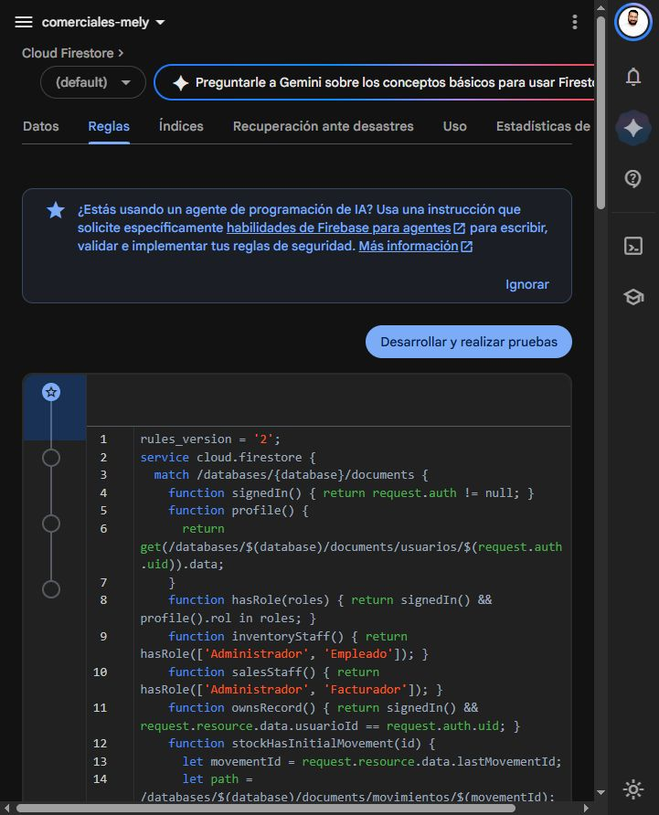

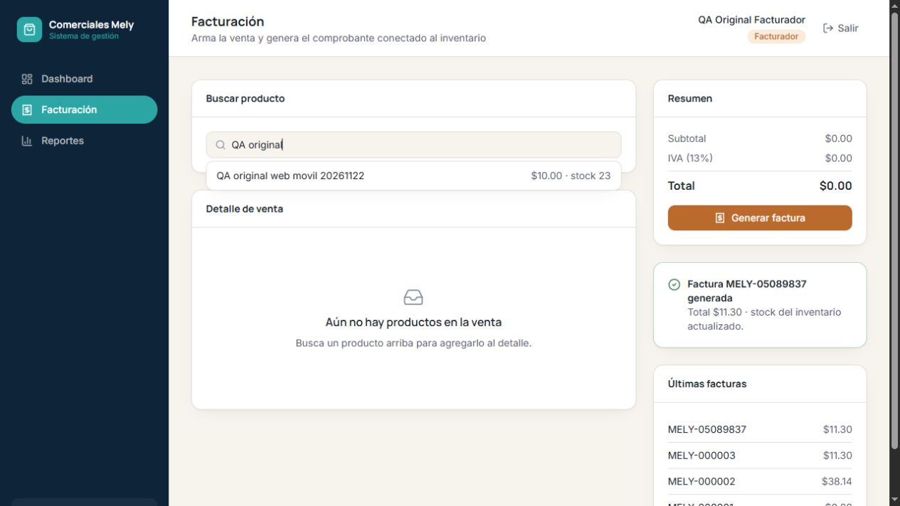

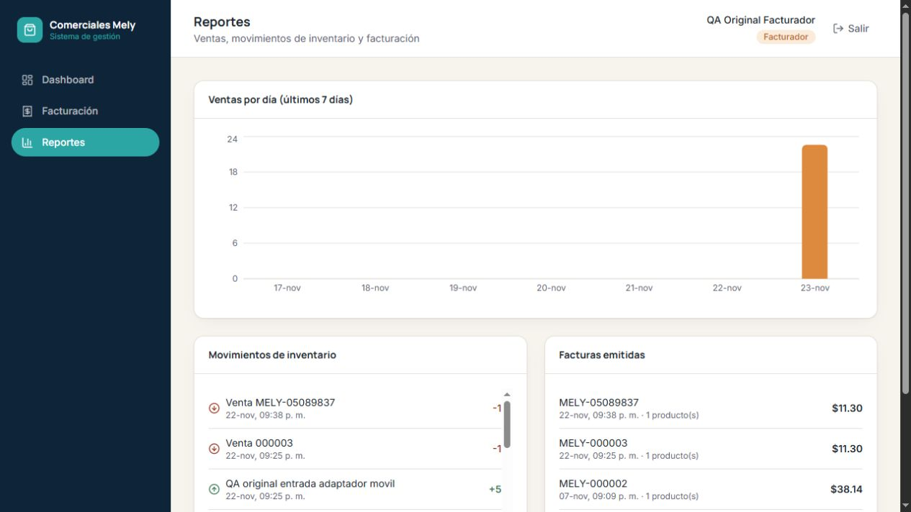

## Producción Vercel y Google

El despliegue usa `config/firebase-client.json` versionado; las variables antiguas de Vercel no lo conectan al entorno temporal. Se comprobó el acceso por correo como Empleado y la lectura del producto QA con stock 23 (captura 43).

El propietario añadió el dominio `comerciales-mely-web.vercel.app` en Authentication del proyecto original. Se verificó su presencia en la lista (captura 44). El acceso Google permitió entrar como Empleado al dashboard y después al inventario, conservando el catálogo original. El gráfico muestra 16–22 de noviembre, ventas del día $22.60 y 4 facturas (captura 45).

El primer intento detectó una condición de carrera entre el observador de sesión y la creación del perfil. `lib/firebase-profile.mjs` utiliza una transacción para crear el perfil una sola vez sin alterar roles existentes. Se añadieron dos pruebas al emulador: creación concurrente y conservación de Administrador; resultado: **18 aprobadas, 0 fallidas**. Referencia de la operación atómica: [documentación Firebase](https://firebase.google.com/docs/firestore/manage-data/transactions).

## APK con el Firebase original

El flujo de GitHub `45114795051`, commit móvil `c0ae962`, generó APK Release ARM64 y x86_64. Se verificaron arquitectura única, bundle JavaScript, presencia del dominio original, ausencia del dominio temporal y firma válida. Las dos firmas coinciden con la SHA-1 registrada en Firebase. Los archivos y hashes están en [android/](../android/README.md). La compilación local Debug x86_64 también terminó correctamente; los archivos entregados son las versiones Release del flujo automatizado.

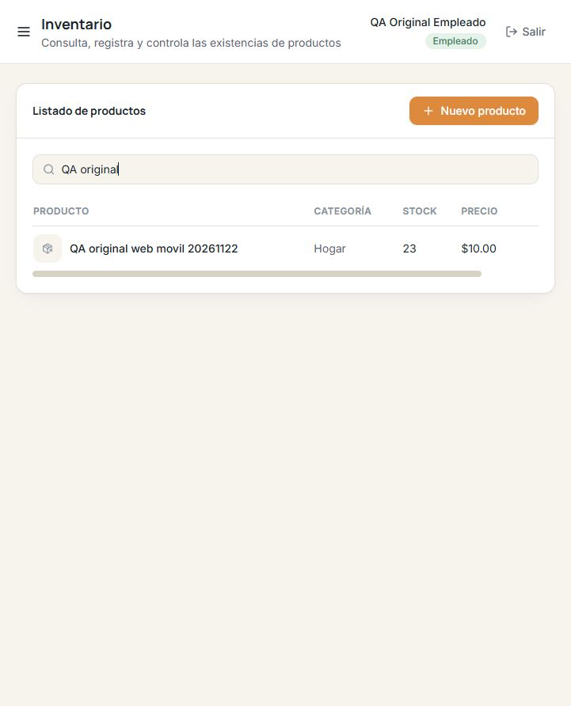

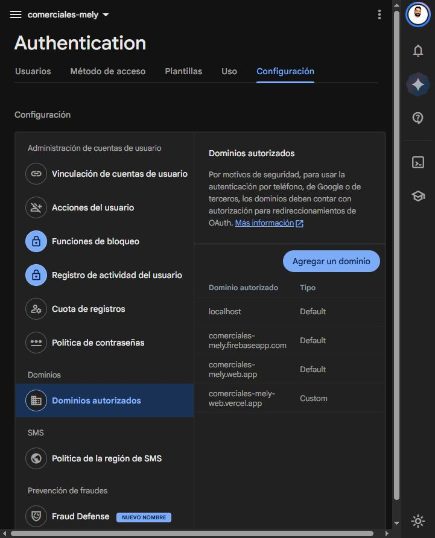

## Aceptación de la APK Release original en Android 14

Se instaló la APK x86_64 publicada, sin Metro. No se sustituyó por Debug para estas pruebas.

| Recorrido desde la interfaz Android | Resultado |
|---|---|
| Acceso por correo como Empleado | Catálogo original visible; producto QA con 23 unidades. Solo funciones autorizadas |
| Entrada de 2 unidades QA | Stock 23 → 25; nota `QA Android original entrada 2` |
| Comprobación en Vercel | La web con sesión Google lee stock 25 |
| Cierre forzado y reapertura | La sesión Empleado se restauró y permitió abrir su perfil sin repetir credenciales |
| Cierre de sesión y correo como Cajero | Acceso correcto; no aparece el botón de crear productos; sí Ventas y Reportes |
| Venta de una unidad QA | `MELY-000005`, cliente `QA Android original`, subtotal $10.00, IVA $1.30 y total $11.30 |
| Comprobación web después de la venta | Stock 24, 5 facturas y $33.90 de ventas del día |
| Reportes Android | $33.90, 5 comprobantes y fecha local 22/11/2026; coinciden con la web |
| Comprobante PDF | Compartir abre el diálogo Android; se guardó mediante Print → Save as PDF, sin enviar a terceros ni elevar permisos |
| Revisión visual del PDF | Una página Letter legible, detalle de una unidad, subtotal/IVA/total correctos, datos sintéticos y aviso académico; sin cortes ni solapamientos |
| Google web tras publicar la corrección | Cierre de sesión, Google y retorno al dashboard confirmados visualmente y por el usuario |
| Google nativo | La APK abrió el acceso oficial de Google en el emulador; espera que el propietario complete su cuenta. No se considera aprobado hasta volver a la app |

El PDF real guardado por Android está en [MELY-000005-QA-Android.pdf](../pdf/MELY-000005-QA-Android.pdf), 53,505 bytes. SHA-256: `c76c9e54fa8a38d7ca8cb94ba96e2bee839bb73756c1197316e39615780fa056`. La captura 57 es su renderizado con Poppler, revisado visualmente.

La protección de perfiles también contempla el registro por correo: el observador espera al formulario para conservar su nombre y rol permitido. Tras añadir ese caso, el emulador Firestore terminó con **19 aprobadas y 0 fallidas**. Las 3 pruebas de calendario y la de configuración compartida volvieron a pasar. Las reglas de seguridad publicadas no se relajaron para completar estos accesos.

Las cuentas y contraseñas QA siguen fuera del repositorio. Las pruebas Android solo añadieron un movimiento y una venta sobre el producto QA; el catálogo anterior del equipo se conserva.

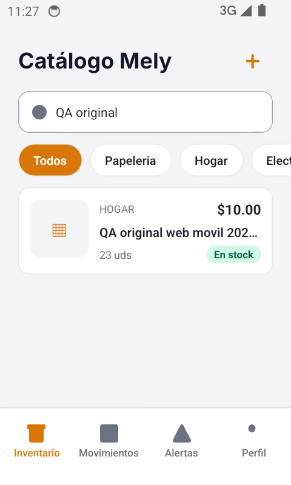

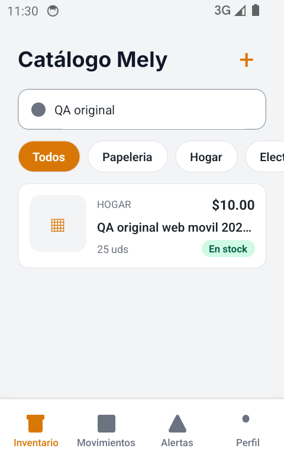

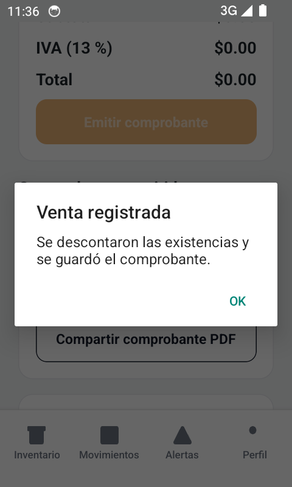

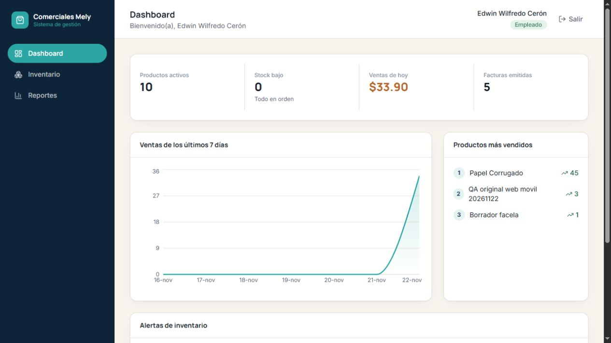

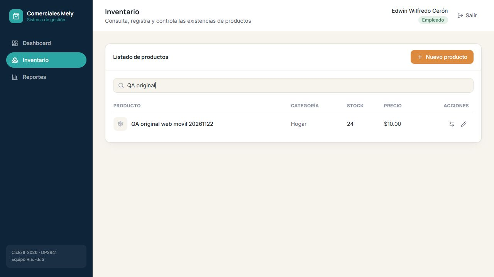

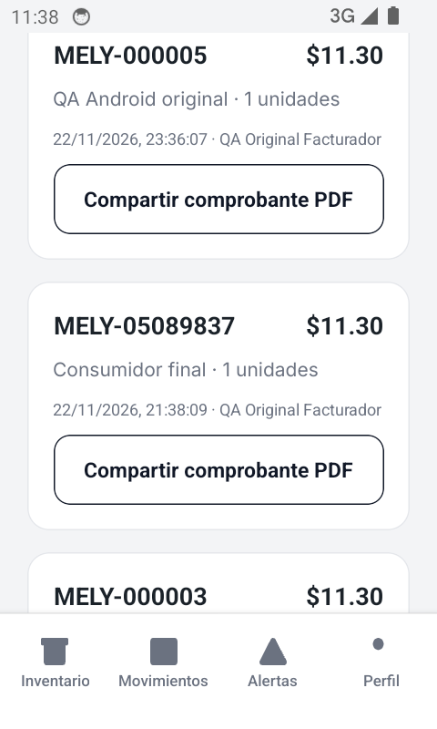

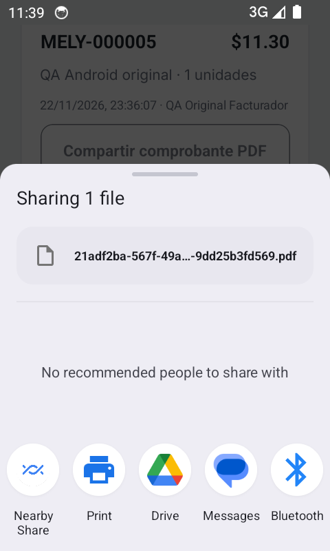

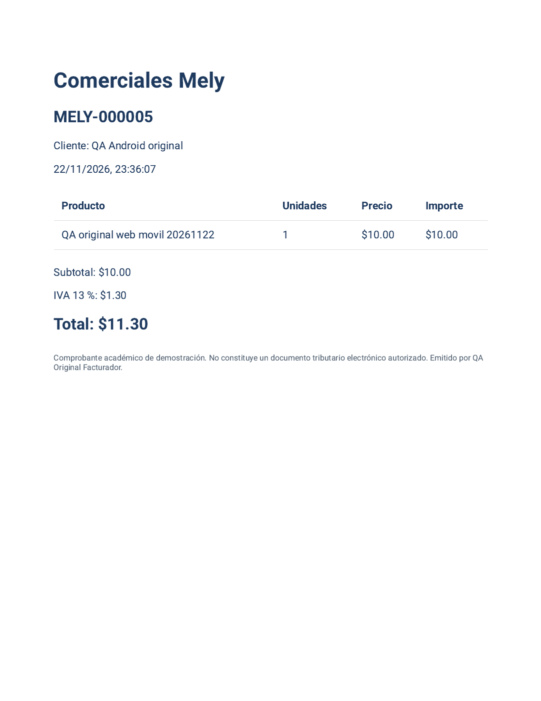

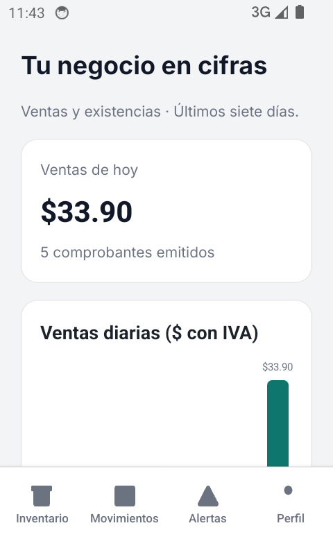
